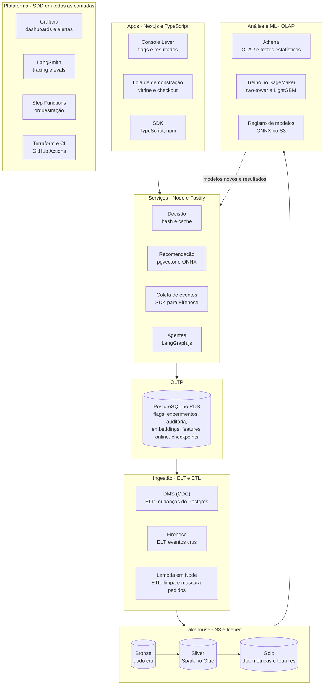

# Lever: plataforma de experimentação e recomendação

29/10/2026 · Abner

## Visão geral

O Lever é uma plataforma de experimentação com um sistema de recomendação acoplado: ele treina modelos de recomendação, coloca cada modelo novo em teste A/B contra o atual e só promove o que ganha com rigor estatístico. É o mesmo ciclo que Netflix, TikTok e Airbnb usam para decidir o que vai para produção.

O projeto tem duas partes que conversam:

- **Plataforma Lever**: feature flags, experimentos A/B, análise estatística e agentes que interpretam resultados. É o produto principal.
- **Loja de demonstração**: um e-commerce fictício que usa o Lever de verdade. Ela gera os eventos, exibe as recomendações e serve de prova de que a plataforma funciona.

**Por que é um projeto nível big tech.** O problema combina escala e precisão. A decisão de qual versão cada usuário vê precisa levar milissegundos, milhões de eventos precisam ser processados, e a estatística precisa estar certa, porque um erro leva a empresa a lançar algo que dá prejuízo. Ele junta sistemas distribuídos, fullstack, engenharia de dados, machine learning e agentes de IA num só sistema coerente.

**Por que combina com você.** Usa a stack que o CTO pediu (JavaScript, TypeScript, Node, Next.js, Postgres e SDD) como base de tudo, e aproveita o que você já domina: pipelines, lakehouse na AWS, estatística da graduação em Data Science e modelos de ML.

## Como funciona

Um modelo de recomendação novo só chega a todos os usuários depois de vencer o atual num teste A/B. A jornada de um usuário mostra o caminho:

1. **A Ana abre a loja.** O app Next.js pede ao Lever qual variante ela deve ver. O serviço de decisão calcula um hash do id dela e sorteia sempre o mesmo grupo: ela cai no grupo B, que usa o modelo de ranqueamento v2.
2. **A loja monta as recomendações.** O serviço de recomendação busca no Postgres, com pgvector, os 200 produtos mais próximos do perfil da Ana. O modelo v2, rodando em ONNX dentro do Node, ordena esses produtos e devolve os 20 primeiros.
3. **A Ana interage.** Cada visualização, clique e compra vira um evento enviado pelo SDK do Lever.
4. **Os eventos vão para o lakehouse.** Eles caem crus na camada bronze (ELT). Os pedidos da loja passam por limpeza antes de carregar (ETL).
5. **As métricas são calculadas.** O dbt monta na gold as métricas de cada grupo (conversão, CTR, receita por usuário) e as features que treinam os próximos modelos. O Athena executa as análises estatísticas.
6. **Os agentes interpretam.** O agente analista escreve o parecer do experimento. O agente guardião acompanha as métricas de proteção e pede rollback se algo piorar.
7. **O time decide.** No console, o time lê o resultado e promove o v2 para 100% dos usuários, ou mantém o v1.

O ciclo se repete: os dados do experimento treinam o modelo seguinte, que entra num novo teste.

## Arquitetura

O dado desce dos apps até a análise e o treino; a seta pontilhada é o retorno, com modelos novos e resultados de experimentos voltando para os serviços. O Postgres guarda o lado transacional e as três camadas Iceberg guardam o lado analítico.

## Stack por camada

TypeScript cobre o produto, as APIs, o ETL e os agentes; Python fica restrito ao Spark e ao treino dos modelos.

| Camada                    | Tecnologia                                                  | Papel                                                                                |
| ------------------------- | ----------------------------------------------------------- | ------------------------------------------------------------------------------------ |
| Monorepo                  | Turborepo, TypeScript, Zod                                  | Schemas compartilhados entre console, loja, APIs, SDK e agentes                      |
| Console Lever             | Next.js (App Router), Auth.js, shadcn/ui                    | Criar experimentos e flags, ver resultados, aprovar rollbacks, chat com agentes      |
| Loja de demonstração      | Next.js                                                     | Vitrine com recomendações, carrinho e checkout que usam o Lever                      |
| Serviço de decisão        | Node, Fastify                                               | Sorteio determinístico por hash, cache em memória, flags em tempo real               |
| Serviço de recomendação   | Node, Fastify, onnxruntime-node                             | Busca vetorial e ranqueamento com o modelo em ONNX                                   |
| SDK                       | TypeScript, publicado no npm                                | Avaliar flags e enviar eventos a partir de qualquer app                              |
| Banco transacional (OLTP) | PostgreSQL no RDS, Drizzle, pgvector                        | Experimentos, flags, auditoria, embeddings, features online, checkpoints dos agentes |
| Coleta de eventos         | Node, Kinesis Data Firehose                                 | Recebe eventos do SDK e grava na bronze                                              |
| ELT                       | DMS (CDC) e Firehose → S3                                   | Dados crus do Postgres e eventos na bronze                                           |
| ETL                       | Lambda em Node                                              | Limpa e mascara pedidos antes de carregar                                            |
| Lakehouse                 | S3, Apache Iceberg, Glue Data Catalog                       | Camadas bronze, silver e gold                                                        |
| Transformação             | Glue (Spark), dbt-athena                                    | Silver com Spark; gold e features com dbt                                            |
| Análise (OLAP)            | Athena                                                      | Métricas por variante e testes estatísticos                                          |
| Machine learning          | Python, LightGBM, PyTorch, SageMaker Training               | Treino do two-tower e do ranqueador; exportação para ONNX                            |
| Registro de modelos       | S3 com metadados no Postgres                                | Versões, métricas offline e status de cada modelo                                    |
| Agentes                   | LangChain.js, LangGraph.js                                  | Supervisor, analista, guardião, ML e planejador de experimentos                      |
| Avaliação de IA           | LangSmith                                                   | Tracing, datasets e evals no CI                                                      |
| Orquestração              | Step Functions, EventBridge                                 | Pipelines diários, treino e cálculo de resultados                                    |
| Observabilidade           | OpenTelemetry, Prometheus, Loki, Tempo, Grafana, CloudWatch | Métricas, logs, traces, dashboards e alertas                                         |
| Qualidade                 | Vitest, Playwright, k6, testes do dbt                       | Unitários, E2E, carga e qualidade de dados                                           |
| Infra e entrega           | Terraform, Docker, GitHub Actions, ECS Fargate              | Infra como código, CI/CD e execução dos serviços                                     |
| Processo                  | SDD (GitHub Spec Kit), ADRs                                 | Spec antes do código e registro das decisões                                         |

## Componentes em detalhe

### Experimentação e feature flags

- **Sorteio determinístico**: hash do id do usuário com a chave do experimento, para a mesma pessoa cair sempre no mesmo grupo sem consultar o banco.
- **Propagação em tempo real**: uma flag alterada no console chega aos serviços via `LISTEN/NOTIFY` do Postgres, sem deploy.
- **Segmentação**: regras por país, dispositivo ou atributo do usuário, e liberação gradual (1%, 10%, 50%, 100%).
- **Estatística**: teste de diferença de proporções e de médias, intervalos de confiança, CUPED para reduzir variância, detecção de SRM (sorteio quebrado) e cálculo de tamanho de amostra.
- **Métricas de proteção**: latência, erros e taxa de cancelamento acompanhadas em todo experimento, com rollback automático sujeito a aprovação.
- **Auditoria**: toda mudança em flag ou experimento gravada com autor, data e diff.

### Recomendação e machine learning

- **Geração de candidatos**: um modelo two-tower (PyTorch) transforma usuários e produtos em vetores. Os vetores ficam no pgvector com índice HNSW, que devolve os 200 mais próximos em milissegundos.
- **Ranqueamento**: LightGBM com LambdaRank ordena os candidatos usando features de preço, categoria, histórico do usuário e popularidade recente.
- **Feature store**: a versão offline fica no Iceberg para treino; a online fica no Postgres para servir. As duas saem do mesmo modelo dbt, evitando diferença entre treino e produção.
- **Serving**: os modelos são exportados para ONNX e executados no serviço Node com onnxruntime-node.
- **Ciclo de vida**: treino agendado, métricas offline (NDCG, recall), registro da versão e entrada automática num experimento contra o modelo atual.

### Dados: OLTP, ELT, ETL e OLAP

- **OLTP**: o Postgres guarda o estado do sistema, com transações, índices pensados e particionamento das tabelas de log.
- **ELT**: eventos do SDK chegam pelo Firehose e alterações do Postgres chegam pelo DMS, crus, na bronze. A transformação acontece depois, dentro do lakehouse.
- **ETL**: pedidos da loja são limpos, deduplicados e têm dados pessoais mascarados numa Lambda antes de carregar.
- **Lakehouse**: bronze, silver e gold em Iceberg no S3. Spark no Glue faz a silver; o dbt faz a gold, com testes de qualidade.
- **OLAP**: o Athena consulta a gold para resultados de experimentos, features de treino e as perguntas dos agentes.

### Agentes de IA

- **Supervisor** (LangGraph.js): recebe as perguntas do console e roteia para o especialista certo.
- **Analista de experimentos**: gera SQL sobre a gold, roda no Athena e escreve o parecer do resultado. Corrige o próprio SQL quando a consulta falha.
- **Guardião**: monitora métricas de proteção e drift das features. Pausa o grafo e pede aprovação humana antes de qualquer rollback.
- **Agente de ML**: compara métricas offline e online e explica por que um modelo ganhou ou perdeu.
- **Planejador**: ajuda a desenhar o experimento, escolher métricas e calcular o tamanho de amostra.
- **Engenharia**: checkpoints do grafo no Postgres, streaming dos passos para o console, ferramentas com permissões mínimas, e tracing, datasets e evals no LangSmith rodando no CI.

### Observabilidade

- **Coleta**: todos os serviços instrumentados com OpenTelemetry. Métricas no Prometheus, logs no Loki, traces no Tempo, mais CloudWatch para os serviços da AWS.
- **Dashboards no Grafana**: latência do serviço de decisão e de cada etapa da recomendação, eventos por segundo, atraso do pipeline, saúde do Postgres, distribuição dos scores dos modelos, drift das features e custo dos agentes.
- **Alertas**: métrica de proteção piorando, SRM detectado, pipeline atrasado ou latência acima do limite.

## O que o projeto demonstra

Um único sistema sustenta conversas técnicas sobre cinco áreas diferentes, todas ligadas entre si.

| Área                  | O que você consegue mostrar                                                                  |
| --------------------- | -------------------------------------------------------------------------------------------- |
| Fullstack             | Dois apps Next.js reais, APIs em Node, SDK publicado, tipagem de ponta a ponta               |
| Sistemas distribuídos | Decisão em milissegundos, cache, propagação em tempo real, idempotência na coleta de eventos |
| Engenharia de dados   | OLTP e OLAP, ELT e ETL com motivo para cada um, lakehouse em Iceberg, feature store          |
| Machine learning      | Two-tower, learning-to-rank, serving em ONNX, diferença entre métrica offline e online       |
| IA e agentes          | Grafo multiagente, aprovação humana, evals no CI, observabilidade de custo e latência        |

Para o CTO, o argumento é que a stack dele é a base de tudo e o resto mostra até onde você vai. Em entrevistas, perguntas como "como a Netflix decide o que te mostrar?" passam a ter uma resposta prática, com código para provar.

## Fases e entregas

Cada fase termina com algo funcionando e publicado no GitHub; a fase 1 sozinha já é um projeto fullstack completo para mostrar ao CTO. As durações são estimativas para um ritmo de estudo paralelo ao trabalho.

| Fase                   | Entrega                                                                 | Pronta quando                                                            | Estimativa    |
| ---------------------- | ----------------------------------------------------------------------- | ------------------------------------------------------------------------ | ------------- |
| 1. Plataforma base     | Console, serviço de decisão, SDK, flags e loja usando o Lever           | Uma flag muda no console e a loja reflete em segundos                    | 4 a 5 semanas |
| 2. Eventos e lakehouse | Coleta de eventos, ELT, ETL, bronze, silver, gold e análise estatística | O console mostra o resultado de um A/B com intervalo de confiança        | 4 semanas     |
| 3. Recomendação e ML   | Two-tower, pgvector, ranqueador, ONNX no Node, registro de modelos      | Dois modelos competem num experimento real na loja                       | 4 a 5 semanas |
| 4. Agentes de IA       | Grafo no LangGraph.js, os cinco agentes, evals no LangSmith             | O analista escreve o parecer e o guardião pede um rollback com aprovação | 3 semanas     |
| 5. Produção            | Grafana completo, testes de carga com k6, Terraform, README e ADRs      | Benchmark publicado e alertas funcionando                                | 2 semanas     |

O Grafana básico e as specs do SDD entram desde a fase 1; a fase 5 só completa e documenta.

## Riscos, custos e cuidados

| Risco                                                           | Cuidado                                                                                                                                      |
| --------------------------------------------------------------- | -------------------------------------------------------------------------------------------------------------------------------------------- |
| Escopo grande demais para terminar                              | Fases independentes; nunca começar uma fase sem a anterior publicada                                                                         |
| Custo na AWS (RDS, SageMaker e Glue cobram por uso ou por hora) | Alerta de orçamento desde o primeiro dia, RDS desligado fora do uso, treino em instâncias spot, Terraform para destruir e recriar o ambiente |
| Falta de dados reais                                            | Gerador de usuários sintéticos com comportamento realista, incluindo preferências que o modelo consiga aprender                              |
| Estatística errada sem perceber                                 | Testes A/A (dois grupos iguais) para validar que a plataforma não acusa diferença falsa                                                      |
| Agentes caros ou imprevisíveis                                  | Limite de custo por execução, evals no CI e aprovação humana em ações com efeito                                                             |
| Conflito com a empresa                                          | Só dados fictícios e nada de código ou documentos da Mission Brasil                                                                          |

## Próximos passos

- \[ \] Mostrar esta ideação ao CTO e confirmar se SDD significa Spec-Driven Development
- \[ \] Criar o monorepo com Turborepo e a pasta `specs/`
- \[ \] Escrever a spec da fase 1: modelo de dados, serviço de decisão, SDK e console
- \[ \] Configurar o alerta de orçamento na AWS antes de criar qualquer recurso